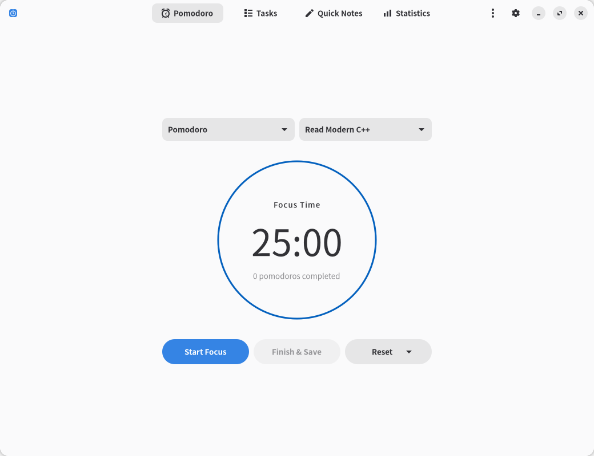
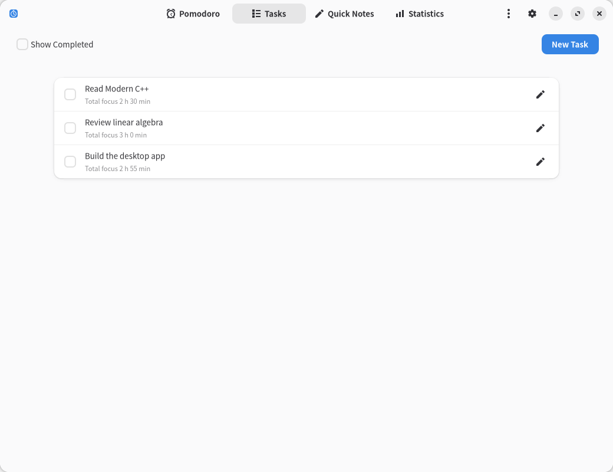
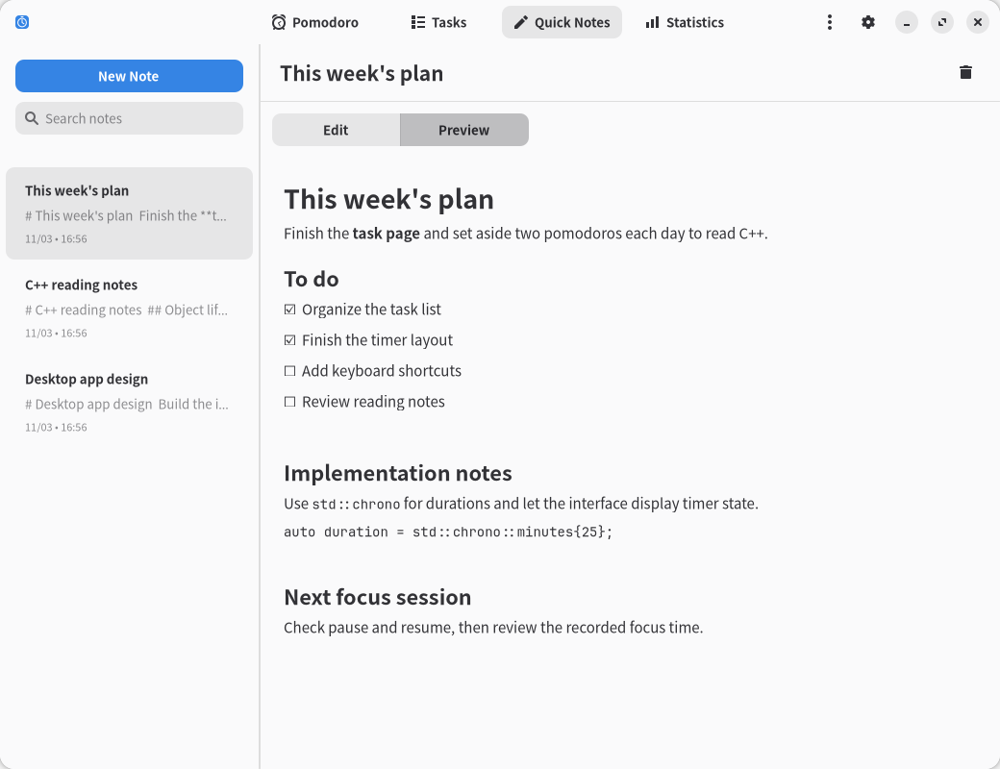
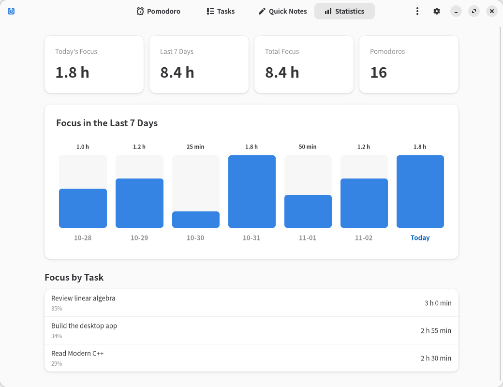
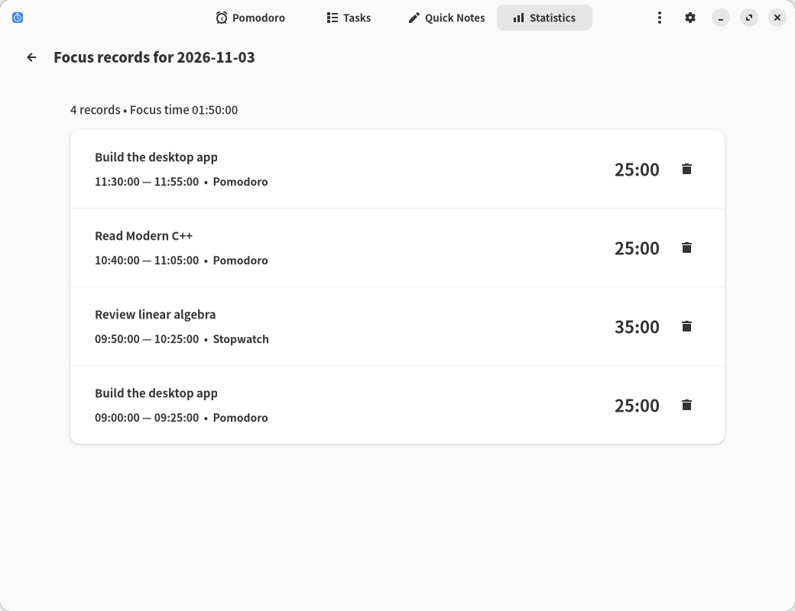

# Focus

**English** · [简体中文](docs/README.zh-CN.md)

Focus is a Linux desktop app with a Pomodoro timer, long-term tasks, Markdown notes, and focus statistics. It is written in C++20 using the GTK4 and libadwaita C APIs. The interface supports English and Simplified Chinese and follows the system's light, dark, and accent color settings.



## Features

- **Pomodoro and stopwatch**: configure focus periods, short and long breaks, and cycle length; pause, resume, or reset timers, with desktop notifications and system sounds.
- **Long-term tasks**: create, rename, complete, and reopen tasks, with cumulative focus time for each task.
- **Quick Notes**: browse notes in a list, search titles and content, save edits automatically, and preview Markdown.
- **Statistics**: view today's, seven-day, and all-time totals, compare time by task, and click a day's bar to inspect or delete individual records.

Timers keep running in the background. The app provides a system tray menu and remembers window dimensions and maximized state. Tasks, notes, settings, and focus records are stored locally. No account is required.

## Screenshots

These screenshots use sample data. Click an image to view it at full size.

| Tasks | Markdown notes |
| --- | --- |
| [](docs/images/tasks-en.png) | [](docs/images/notes-en.png) |

| Statistics | Daily records |
| --- | --- |
| [](docs/images/statistics-en.png) | [](docs/images/records-en.png) |

## Build and installation

Run Focus in a Linux desktop session with Wayland or X11. Install the following tools and development libraries before building:

| Category | Dependencies |
| --- | --- |
| Build tools | C++20 compiler, CMake ≥ 3.24, Ninja, pkg-config, GNU gettext |
| Interface | GTK ≥ 4.16, libadwaita ≥ 1.6, GLib |
| Storage and Markdown | SQLite3, cmark-gfm |
| Desktop integration | libdbusmenu-glib, libcanberra |

```bash
git clone https://github.com/AkiraLyu/focus.git
cd focus
cmake -S . -B build -G Ninja \
  -DCMAKE_BUILD_TYPE=Release -DBUILD_TESTING=OFF
cmake --build build --parallel
./build/focus
```

Install for the current user:

```bash
cmake --install build --prefix "$HOME/.local"
```

The executable is installed to `~/.local/bin/focus`. The desktop entry, icon, and translations are installed under `~/.local/share/`. Add `~/.local/bin` to `PATH` to run `focus` from a terminal.

Arch Linux users can build the included [PKGBUILD](packaging/arch/PKGBUILD). With `base-devel` and `git` installed, run these commands from the repository root:

```bash
cd packaging/arch
makepkg -si
```

The package fetches source from the default branch on GitHub. System sounds require an XDG sound theme such as `sound-theme-freedesktop`. The tray menu requires a desktop that supports StatusNotifierItem.

## Usage

The default cycle uses 25-minute focus periods, 5-minute short breaks, and a 15-minute long break after four pomodoros. Adjust these values with the settings button in the header. Each phase waits for you to start the next one. Create a task on the Tasks page, then select it on the Pomodoro page. Choose Free Focus to time a session without a task.

Finish & Save retains the session's focus time in statistics. Reset Current Timer discards the current focus record. Reset Pomodoro Cycle discards every focus record in the current cycle and returns to its first round. Choosing Reset Current Timer during a break restores that break's full duration. Breaks and pauses do not count toward focus time.

Quick Notes supports Markdown headings, lists, task lists, quotes, code, and tables. Links and images are displayed as text. Edits are saved automatically to the local database.

Click a day's bar on the Statistics page to see tasks, focus durations, and start and end times. Deleting a record that spans midnight removes its time from every affected date. Detailed records are retained; the seven-day limit applies only to the chart.

### Background operation

| Action | Behavior |
| --- | --- |
| Close the window or press `Ctrl+W` | Hide the window and keep the timer running |
| Launch Focus again | Show the existing window |
| Choose Quit in the app or tray menu, or press `Ctrl+Q` | Save data and exit |

The tray menu lets you show the window, start or pause the timer, and quit. If the desktop has no tray service, launch Focus again to show its window. When a focus period or break ends naturally, the app sends a desktop notification and plays a sound according to the system's sound settings.

### Interface language

Focus reads the system language at startup. It supports English and Simplified Chinese and falls back to English for other languages. You can also choose a language when launching:

```bash
LANGUAGE=en LC_ALL=en_US.UTF-8 ./build/focus
LANGUAGE=zh_CN LC_ALL=zh_CN.UTF-8 ./build/focus
```

These commands require the corresponding UTF-8 locales to be generated on the system. Quit any running instance before switching languages. Task names and note content remain as entered.

## Data and backups

The default database path is `~/.local/share/focus/focus.db`. If `XDG_DATA_HOME` is set, the path is `$XDG_DATA_HOME/focus/focus.db`.

Before backing up or moving data, quit through the menu or press `Ctrl+Q`, then copy the entire `focus` data directory. Closing the window leaves the background process running. SQLite may use additional WAL files while the app is active.

## Development

The timer state machine and SQLite storage layer are independent of GTK. The interface is split into page modules. Localization uses gettext, with Simplified Chinese translations in [po/zh_CN.po](po/zh_CN.po). The [usage and development guide](docs/使用与开发.md) covers module boundaries, timer rules, and translation maintenance in Chinese.

Enable the core behavior and localization tests:

```bash
cmake -S . -B build -G Ninja -DBUILD_TESTING=ON
cmake --build build --parallel
ctest --test-dir build --output-on-failure
```

Test builds require `localedef`, the `en_US` locale definition, and the UTF-8 character map to generate a private locale in the build directory. In a desktop session, add `-DFOCUS_DESKTOP_TESTS=ON` to enable background lifecycle and tray integration tests.

## License

[MIT](LICENSE)
