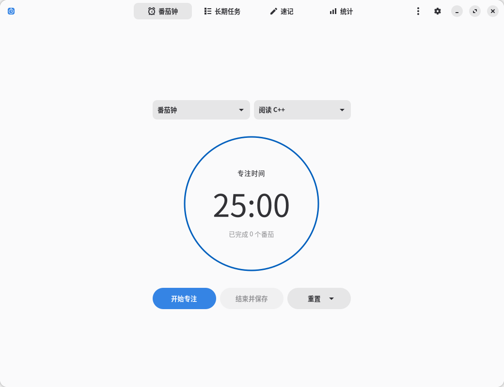
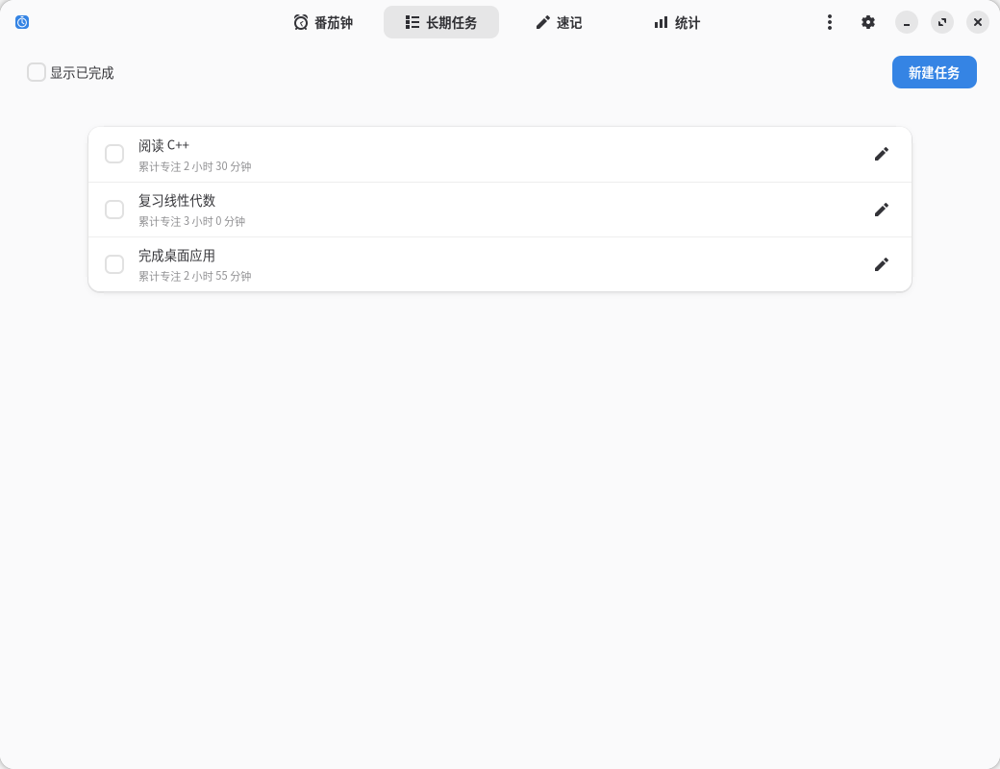
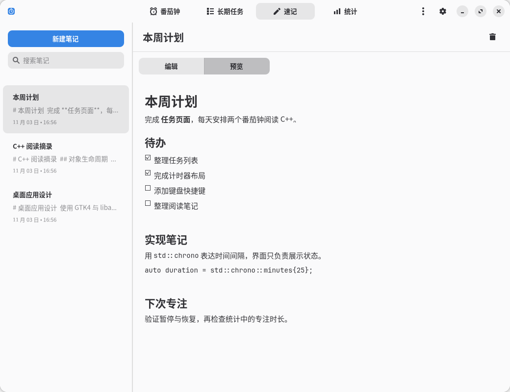
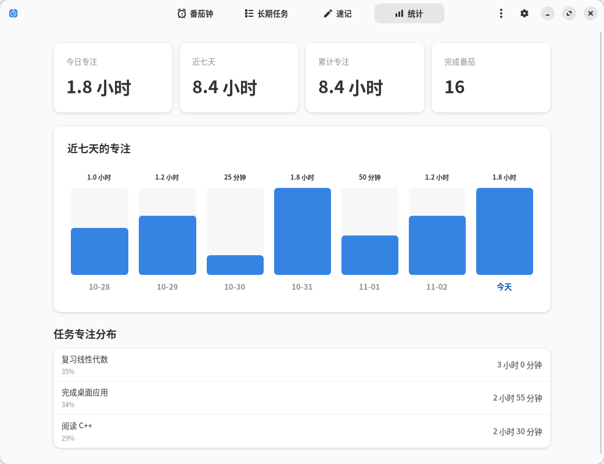
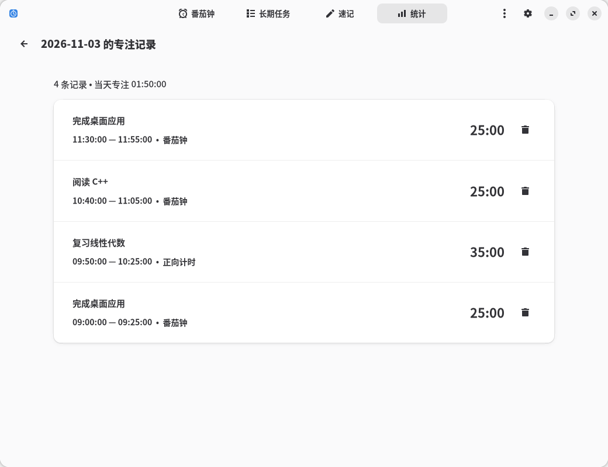

# 专注 · Focus

[English](../README.md) · **简体中文**

Focus 是一款 Linux 桌面专注工具，提供番茄钟、长期任务、Markdown 速记和专注统计。应用使用 C++20 开发，通过 GTK4 与 libadwaita 的 C 接口构建原生界面，支持简体中文和英文，并跟随系统的浅色、深色及强调色设置。



## 功能

- **番茄钟与正向计时**：自定义专注、短休息、长休息和循环轮次；支持暂停、继续、重置、桌面通知和系统提示音。
- **长期任务**：创建、改名、完成和重新打开任务，累计每个任务的专注时长。
- **速记**：按条目管理笔记，搜索标题和正文，自动保存，支持 Markdown 编辑与预览。
- **专注统计**：查看今日、近七天和累计时长，按任务汇总；点击每日柱状图查看明细及删除记录。

计时可在后台继续运行。应用提供系统托盘菜单，并记住窗口大小和最大化状态。任务、笔记、设置及专注记录均保存在本地，无需账户。

## 截图

以下截图使用示例数据，点击图片可查看原图。

| 长期任务 | Markdown 速记 |
| --- | --- |
| [](images/tasks-zh-CN.png) | [](images/notes-zh-CN.png) |

| 统计概览 | 每日明细 |
| --- | --- |
| [](images/statistics-zh-CN.png) | [](images/records-zh-CN.png) |

## 构建与安装

运行需要 Linux 的 Wayland 或 X11 桌面会话。构建前安装以下工具及库的开发文件：

| 类别 | 依赖 |
| --- | --- |
| 构建工具 | C++20 编译器、CMake ≥ 3.24、Ninja、pkg-config、GNU gettext |
| 界面 | GTK ≥ 4.16、libadwaita ≥ 1.6、GLib |
| 存储与 Markdown | SQLite3、cmark-gfm |
| 桌面集成 | libdbusmenu-glib、libcanberra |

```bash
git clone https://github.com/AkiraLyu/focus.git
cd focus
cmake -S . -B build -G Ninja \
  -DCMAKE_BUILD_TYPE=Release -DBUILD_TESTING=OFF
cmake --build build --parallel
./build/focus
```

安装到用户目录：

```bash
cmake --install build --prefix "$HOME/.local"
```

可执行文件位于 `~/.local/bin/focus`，桌面入口、图标和翻译文件位于 `~/.local/share/`。将 `~/.local/bin` 加入 `PATH` 后，即可从终端执行 `focus`。

Arch Linux 用户可使用仓库中的 [PKGBUILD](../packaging/arch/PKGBUILD)。安装 `base-devel` 和 `git` 后，在仓库根目录执行：

```bash
cd packaging/arch
makepkg -si
```

该软件包从 GitHub 默认分支拉取源码构建。系统提示音需要 XDG 声音主题，例如 `sound-theme-freedesktop`；托盘菜单需要桌面支持 StatusNotifierItem。

## 使用

番茄钟默认专注 25 分钟、短休息 5 分钟、长休息 15 分钟，每完成 4 个番茄进入长休息。右上角的设置按钮可调整这些周期，每个阶段结束后由用户手动开始下一阶段。在长期任务页创建任务后，可在番茄钟页面选择任务；自由专注用于不关联任务的计时。

结束并保存会将本次专注时长保留在统计中。重置当前计时会清除当前专注记录；重置整个番茄钟周期会清除本周期全部专注记录，并返回第一轮。在休息阶段选择重置当前计时，会恢复该段休息的完整时长。休息和暂停时间不计入专注统计。

速记支持标题、列表、任务列表、引用、代码和表格等 Markdown 内容。链接和图片以文字形式展示。编辑后的内容会自动保存到本地数据库。

点击统计页的每日柱状图，可查看任务、专注时长、开始时间和结束时间。删除跨天记录会同时移除其在其他日期的时长。历史明细长期保留，近七天仅为图表的显示范围。

### 后台运行

| 操作 | 行为 |
| --- | --- |
| 关闭窗口或 `Ctrl+W` | 隐藏窗口，保持后台计时 |
| 再次启动 Focus | 显示已有窗口 |
| 应用菜单或托盘菜单中的退出，或 `Ctrl+Q` | 保存数据并退出应用 |

托盘提供显示窗口、开始或暂停计时及退出操作。桌面没有托盘服务时，再次启动 Focus 也可显示原窗口。自然结束的专注或休息阶段会发送桌面通知，并按系统音效设置播放提示音。

### 界面语言

应用在启动时读取系统语言，支持简体中文和英文，其他语言回退到英文。也可指定语言启动：

```bash
LANGUAGE=zh_CN LC_ALL=zh_CN.UTF-8 ./build/focus
LANGUAGE=en LC_ALL=en_US.UTF-8 ./build/focus
```

这些命令要求系统已生成对应的 UTF-8 locale。切换前先退出正在运行的实例。任务名称和笔记内容保持原文。

## 数据与备份

默认数据库路径为 `~/.local/share/focus/focus.db`。设置了 `XDG_DATA_HOME` 时，路径为 `$XDG_DATA_HOME/focus/focus.db`。

备份或迁移前，通过退出菜单或 `Ctrl+Q` 退出应用，再复制整个 `focus` 数据目录。仅关闭窗口会保留后台进程；运行期间 SQLite 可能使用附属的 WAL 文件。

## 开发

计时状态机和 SQLite 存储层独立于 GTK，界面按页面拆分。国际化使用 gettext，中文翻译位于 [po/zh_CN.po](../po/zh_CN.po)。完整的模块说明、计时规则与翻译维护流程见[使用与开发](使用与开发.md)。

启用核心行为和语言测试：

```bash
cmake -S . -B build -G Ninja -DBUILD_TESTING=ON
cmake --build build --parallel
ctest --test-dir build --output-on-failure
```

测试构建需要 `localedef`、`en_US` locale 定义和 UTF-8 字符映射，用于生成构建目录中的私有测试 locale。在可用的桌面会话中，增加 `-DFOCUS_DESKTOP_TESTS=ON` 可启用后台生命周期和托盘集成测试。

## 许可证

[MIT](../LICENSE)
